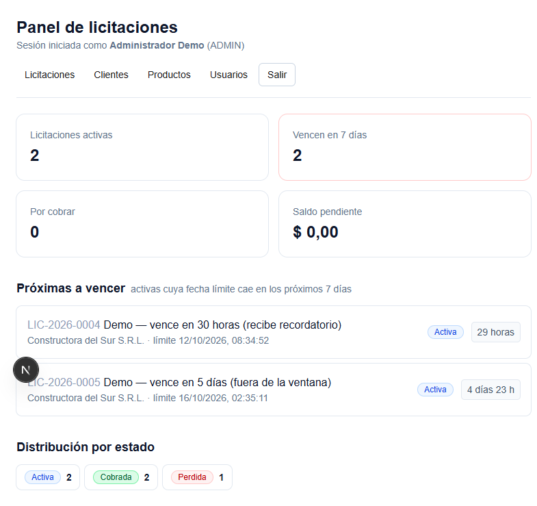
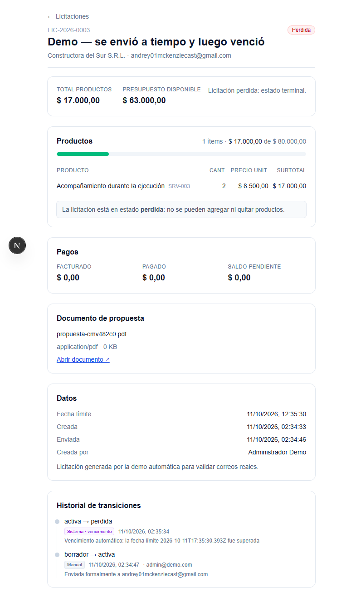

# Sistema de Gestión de Licitaciones

Aplicación para administrar licitaciones comerciales de punta a punta: se redacta una
licitación, se le adjunta una propuesta, **se envía formalmente al cliente por correo con
el PDF adjunto**, se le hace seguimiento hasta su fecha límite con recordatorios, se resuelve
(ganada o perdida) y, si se ganó, se factura y cobra hasta saldar. Todo auditado paso a paso.



---

## 1. Qué hace

```
   crear borrador  →  agregar productos  →  subir PDF  →  ENVIAR
        (estado         (valida            (Storage)     (correo real
        borrador)        presupuesto)                    + adjunto)
                                                              │
                        ┌─────────────────────────────────────┘
                        ▼
              recordatorios a < 48 h de vencerse  (job programado)
                        │
        ┌───────────────┴───────────────┐
        ▼                               ▼
  perdida (venció)            finalizada (ganada)
                                        │
                                        ▼
                                  por_cobrar ──pagos──▶ cobrada
                                                   (automático al saldar)
```

Cada flecha es una transición **validada contra una tabla** y **registrada en el historial**
con estado anterior, estado nuevo, usuario, origen y fecha.

---

## Requisitos del enunciado: donde vive cada uno

Tabla de trazabilidad. Cada fila se puede comprobar con un comando concreto.

| Requisito | Implementacion | Como se verifica |
|---|---|---|
| R1 No exceder el presupuesto maximo | `src/lib/reglas.ts` `assertDentroDePresupuesto` | Agregar producto que desborda: `422 PRESUPUESTO_EXCEDIDO` |
| R2 Vencimiento automatico | `src/app/api/cron/licitaciones/route.ts` paso 1 | Correr el cron con una activa vencida: queda `perdida`, `origen: automatica` |
| R3 No enviar sin documento | `src/lib/reglas.ts` `assertTieneDocumento` | Enviar sin subir PDF: `422 DOCUMENTO_FALTANTE` |
| R4 Correo real con adjunto | `src/lib/email/enviar.ts` | Correo recibido con el PDF visible abajo |
| R5 Recordatorio < 48 h | cron paso 2 + `entraEnVentanaRecordatorio` | Activa a 30 h: llega recordatorio. A 5 dias: no |
| R6 Pagos y paso a `cobrada` | `src/lib/licitaciones/pagos.ts` | Pago mayor al saldo: `422`. Saldo a cero: `cobrada` sola |
| R7 Historial de transiciones | `src/lib/transiciones.ts` `cambiarEstado` | `GET /api/licitaciones/:id/historial` |
| Solo admin crea usuarios | `requireAdmin()` en el endpoint + chequeo en el proxy | `POST /api/usuarios` como USER: `403` |
| Solo `borrador` y `activa` editan | `assertEditable` | Agregar producto en `finalizada`: `409` |
| Estados y transiciones | `src/lib/estados.ts` | 36 combinaciones contra la tabla del enunciado |
| Auditoria en cada entidad | `prisma/schema.prisma` | Campos `creadoPorId` / `actualizadoPorId` / `*_en` |
| Tabla puente N:M con precio | `LicitacionProducto.precioUnitario` | El precio queda congelado al agregar |
| Documentación de la API *(extra)* | `src/lib/openapi.ts` | `/api-docs` renderiza; `/api/openapi` devuelve el spec |

**Verificacion reproducible:**

```bash
npm test                  # 52 tests de la logica pura
npm run test:smoke        # 54 verificaciones del flujo completo por HTTP
npm run test:paginas      # 15 verificaciones de pantallas, permisos y documentación
npm run test:produccion   # 18 verificaciones contra el deploy real
```

---

## 2. Stack

| Capa | Elección | Por qué |
|---|---|---|
| Framework | **Next.js 16.4** (App Router) + TypeScript | API + UI + job programado en un solo repo |
| Base de datos | **Supabase PostgreSQL 17** (plan free) | El enunciado lo permite; la máquina de desarrollo no tiene Docker |
| ORM | **Prisma 6** | Migraciones y tipos generados |
| Auth | **JWT en cookie httpOnly** con `jose` | ~40 líneas explicables, sin beta de librerías |
| Email | **Resend** (plan free) | Adjuntos reales vía `attachments` |
| Archivos | **Supabase Storage**, bucket privado `propuestas` | URL firmada real y revocable |
| Job | **Endpoint HTTP** + Vercel Cron / GitHub Actions | El transporte es intercambiable |
| Tests | **Vitest** (unitarios) + **script de humo** (end-to-end) | Las reglas críticas se prueban sin base de datos |

---

## 3. Instalación local

Requisitos: **Node 20.9+** (probado en 22.14). No hace falta Docker ni Python.

```bash
git clone <url-del-repo>
cd licitaciones
npm install

# 1. Copiar la plantilla de variables y completarla
cp .env.example .env       # Windows: Copy-Item .env.example .env

# 2. Aplicar el schema a la base
npx prisma db push

# 3. Cargar los datos de prueba (usuarios, clientes, productos)
npm run db:seed

# 4. Crear el bucket de Storage (privado, 10 MB, PDF/DOC/DOCX)
npm run storage:setup

# 5. Levantar
npm run dev
```

Abrir <http://localhost:3000>.

### Cuentas de prueba

| Email | Contraseña | Rol |
|---|---|---|
| `admin@demo.com` | `Admin123!` | ADMIN |
| `user@demo.com` | `User123!` | USER |

---

## 4. Variables de entorno

| Variable | Para qué sirve | Nota |
|---|---|---|
| `DATABASE_URL` | Conexión de la app | **Pooler** de Supabase. Vercel corre en serverless: sin pooler se agota el límite de conexiones |
| `DIRECT_URL` | Migraciones | Conexión directa. `prisma migrate` usa siempre `directUrl` si está declarado |
| `AUTH_SECRET` | Firma el JWT | Sin ella, `encode(undefined)` firmaría con clave vacía y cualquiera podría forjar un rol ADMIN |
| `CRON_SECRET` | Protege `/api/cron/licitaciones` | Vercel lo manda automático si la variable existe con ese nombre |
| `RESEND_API_KEY` | Proveedor de email | Sin esto el envío **falla con error**, no se simula |
| `EMAIL_FROM` | Remitente | `onboarding@resend.dev` o un dominio verificado |
| `EMAIL_CLIENTE_DEMO` | Email del cliente de prueba | Ver sección de Resend más abajo |
| `NEXT_PUBLIC_SUPABASE_URL` / `_ANON_KEY` | Cliente de Storage | `anon` respeta RLS |
| `SUPABASE_SERVICE_ROLE_KEY` | Subida de archivos | Ignora RLS. **Nunca** con `NEXT_PUBLIC_` |

Generar secretos:

```bash
node -e "console.log(require('crypto').randomBytes(32).toString('base64'))"
```

### ⚠️ Trampa del pooler de Supabase

El host del pooler es **`aws-1-us-west-2.pooler.supabase.com`**: el prefijo es `aws-1`,
**no** `aws-0`. Ese `aws-1` es específico del proyecto y no se puede deducir; con `aws-0` el
pooler responde `tenant/user <ref> not found` aunque usuario, contraseña y región sean
correctos. Hay que copiar la cadena desde **Project Settings → Database → Connection string**.

Además, la conexión directa `db.<ref>.supabase.co` resuelve **solo a IPv6**. En una red sin
salida IPv6 falla siempre con `P1001`, por eso ambas variables apuntan al pooler.

### ⚠️ `connection_limit=1`: el bug que no parece un bug

Con `connection_limit=5` en la URL, el proyecto funcionaba en local y se caía solo en
producción. Los síntomas parecían de autenticación:

- `/dashboard` redirigía al login aunque la cookie fuese válida.
- `POST /api/auth/login` devolvía **500**.
- `/api/openapi` y `/api/auth/me` respondían bien.

La causa no era la sesión: era que **todas las requests que tocan la base fallaban**, y las
que no la tocan, no. En Vercel conviven varias instancias de serverless, cada una abriendo
hasta 5 conexiones al pooler de Supabase. Cuando se pasa el tope del pooler, no avisa:
simplemente deja de aceptar conexiones, y la app entera devuelve 500. Después de unos
minutos sin tráfico, las conexiones se liberan y todo vuelve a funcionar solo, lo que hace
el diagnóstico todavía más confuso.

Se arregla en `src/lib/db.ts`: si la URL no trae `connection_limit`, se le agrega `=1`.
Cada instancia abre a lo sumo una conexión, que es lo que corresponde cuando hay un pooler
adelante — las requests de una instancia ya se serializan solas.

Se hace con concat de strings y no con `new URL()` a propósito: el parser normaliza y
re-escapa usuario y contraseña, y un escapado distinto rompe la autenticación contra el
pooler. Agregar un parámetro de query es un cambio de texto plano que no puede tocar las
credenciales. Hay un test (`src/lib/__tests__/db.test.ts`) que lo verifica.

> ParaEvaluator: si clonás el repo, `connection_limit=1` ya viene en `.env.example` y
> `src/lib/db.ts` lo aplica igual si tu URL no lo trae. No hace falta tocar nada.

---

## 5. Correo: qué permite el plan gratuito

Con el remitente `onboarding@resend.dev`, Resend **solo permite enviar al email de la cuenta
titular**:

> You can only send testing emails to your own email address (…). To send emails to other
> recipients, please verify a domain at resend.com/domains.

Por eso `EMAIL_CLIENTE_DEMO` apunta el cliente de prueba a ese mismo email. Para enviar a
destinatarios reales hay que **verificar un dominio** en [resend.com/domains](https://resend.com/domains)
(agregar un registro TXT en DNS, minutos u horas) y cambiar `EMAIL_FROM` a ese dominio. Ninguna
línea de código cambia: ya usa `process.env.EMAIL_FROM`.

---

## 6. Reglas de negocio: dónde vive cada una

| Requisito | Implementación | Cómo se verifica |
|---|---|---|
| R1 · No exceder el presupuesto máximo | `assertDentroDePresupuesto` + `agregarProducto` (transaccional) | Agregar producto que desborda → `422 PRESUPUESTO_EXCEDIDO` |
| R2 · Vencimiento automático | `api/cron/licitaciones`, paso 1 | Correr el cron con una activa vencida → queda `perdida`, `origen: automatica` |
| R3 · No enviar sin documento | `assertTieneDocumento` (valida `documentoPath`) | Enviar sin subir PDF → `422 DOCUMENTO_FALTANTE` |
| R4 · Correo real con adjunto | `email/enviar-propuesta.ts` | Correo recibido con el PDF visible |
| R5 · Recordatorio < 48 h | Mismo cron, paso 2 | Activa a 30 h → llega recordatorio; a 5 días → no |
| R6 · Pagos y paso a `cobrada` | `registrarPago` con `SELECT ... FOR UPDATE` | Saldo a cero → `cobrada` sola, `origen: sistema` |
| R7 · Historial de toda transición | `cambiarEstado()` escribe el historial en la misma transacción | `GET .../historial` |
| Solo `borrador` y `activa` aceptan productos | `assertEditable` | Agregar en `finalizada` → `409` |
| Solo admin crea usuarios | `requireAdmin()` en el endpoint **y** en la página | `POST /api/usuarios` como user → `403` |

---

## 7. Arquitectura

```
Navegador
   │
   ▼
src/proxy.ts                 verifica el JWT y redirige (optimización de UX)
   │
   ▼
src/app/api/**/route.ts      valida input con Zod, llama a lib/, traduce errores
   │                         ← CERO lógica de negocio en las rutas
   ▼
src/lib/reglas.ts            funciones PURAS: presupuesto, saldo, documento, estados
src/lib/transiciones.ts      cambiarEstado(): único punto que escribe `estado`
   │
   ▼
src/lib/db.ts ──────────► PostgreSQL (Supabase)

Fuera de la transacción de DB:
src/lib/email/*           Resend (correo + adjunto)
src/lib/storage.ts        Supabase Storage (bucket privado)
```

**Por qué las reglas son funciones puras:** se testean sin base de datos. `estados.test.ts`
recorre las **36 combinaciones** de estado usando la tabla del enunciado escrita a mano como
especificación ejecutable: si alguien "arregla" la tabla, el test falla.

**Por qué el frontend no reimplementa la tabla de estados:** `GET /api/licitaciones/:id`
devuelve `transicionesDisponibles` y `editable`, calculados por el servidor. La UI dibuja
los botones a partir de eso. Si el frontend tuviera su propia copia, el día que se agregue un
estado mostraría un botón que el backend rechaza con 422.

---

## 8. Decisiones de diseño

**Montos en enteros (centavos).** `0.1 + 0.2 !== 0.3` en IEEE 754. Un saldo con float termina
con diferencias de un centavo y tests que fallan sin explicación. Todo se guarda y se calcula
como entero; `Intl.NumberFormat` solo formatea para mostrar.

**`SELECT ... FOR UPDATE` en los pagos.** Sin ese lock, dos requests de pago simultáneos leen
el **mismo** saldo, los dos validan y los dos insertan: cobrás el doble de lo facturado.
`FOR UPDATE` bloquea la fila de la licitación hasta que la transacción termine.

**Reclamo atómico en el recordatorio.** El cron marca `recordatorioEnviadoEn` con un
`updateMany` filtrando por el mismo `null`. Dos ejecuciones solapadas ven ambas `null`, pero
solo una obtiene `count: 1`; la otra se saltea. Con `find` + `update` llegarían dos correos.

**El correo va después de la transición, fuera de la transacción.** Si transiciono primero y
el email falla, la licitación queda `activa` con su historial y el correo se reenvía. Si mando
el email primero y la transición falla, mandé una propuesta "oficial" de algo que sigue en
borrador. Además una llamada de red de 2 s dentro de una transacción mantiene el lock de la fila.

**Timestamps contextuales.** `enviadaEn`, `resueltaEn` y `cerradaEn` son campos separados de
`creadoEn`. Para auditar "se envió antes del plazo" hay que saber *cuándo se envió*.

**Bucket privado + URL firmada.** Un bucket público genera links que no se pueden revocar. Con
bucket privado se guarda el `path` y el link se firma en el momento de necesitarlo.

**`cambiarEstado()` es el único que escribe `estado`.** El historial se escribe en la misma
transacción que el update: o quedan los dos o no queda ninguno. Las automáticas van con
`usuarioId: null` y `origen: automatica | sistema`, que es lo que hace verificable el requisito 2.

**`precioUnitario` congelado en el ítem.** Si mañana se reprecia el catálogo, una licitación de
hace 6 meses debe seguir mostrando el precio con el que se presupuestó.

**`montoFacturado` aparte de `totalProductos`.** Se puede presupuestar $1.000.000 y facturar
$950.000 con un descuento negociado. Si fueran siempre iguales, no se podría modelar una
negociación y el requisito 6 no tendría sentido.

---

## 9. Pruebas

```bash
npm test          # 52 tests unitarios de la lógica pura (sin base de datos)
npm run typecheck # TypeScript estricto
npm run test:smoke  # 54 verificaciones end-to-end contra el server corriendo
```

`test:smoke` recorre el flujo completo y verifica los caminos de error, que es lo que más se
evalúa: presupuesto excedido, transición inválida, envío sin documento, pago mayor al saldo,
rol insuficiente, cron sin secreto.

Para la demo con correos reales:

```bash
npx tsx --env-file=.env scripts/demo-email.ts
```

Crea tres licitaciones (una que vence ya, otra en 30 h, otra en 5 días), envía las tres
propuestas con PDF adjunto, corre el job y muestra el resultado.

---

## 10. Job programado

```bash
# Con el server local corriendo
curl -H "Authorization: Bearer $CRON_SECRET" http://localhost:3000/api/cron/licitaciones
```

Respuesta real de la demo:

```json
{"ejecutadoEn":"2026-10-11T19:35:32.426Z","vencidas":1,"recordatorios":1,"errores":[]}
```

Orden interno: **primero vence, después recuerda**. Si fuera al revés, una licitación vencida
hace una hora entraría en la ventana de 48 h y su cliente recibiría un "¡tenés tiempo!" de algo
que ya venció.

En producción se dispara con Vercel Cron (`vercel.json`) o con GitHub Actions, que golpea el
mismo endpoint. El plan Hobby de Vercel corre **una vez por día**, por eso el endpoint acepta
también POST y las llamadas manuales.

---

## Demo en produccion

**<https://licitaciones-mu-sepia.vercel.app>**

| Rol | Usuario | Contrasena |
|---|---|---|
| Administrador | `admin@demo.com` | `Admin123!` |
| Usuario | `user@demo.com` | `User123!` |

Verificacion automatica contra el entorno desplegado:

```bash
SMOKE_BASE_URL=https://licitaciones-mu-sepia.vercel.app npx tsx --env-file=.env scripts/ver-produccion.ts
```

Comprueba 18 cosas: que el sitio sea publico, que la API responda contra la base real,
que los roles se respeten, que las reglas de negocio devuelvan los errores correctos
y que las seis pantallas rendericen.

---

## 11. Despliegue

1. Subir el repo a GitHub (público).
2. En [vercel.com/new](https://vercel.com/new) → Import Project → elegir el repo.
3. Cargar **todas** las variables de `.env.example`.
4. Deploy.

Como `cacheComponents` está desactivado a propósito (el 100 % de las páginas requiere sesión y
con `true` leer la cookie fuera de un `<Suspense>` es error de build), el build es el de
Turbopack por defecto.

---

## 12. Evidencia

| Qué | Dónde |
|---|---|
| Login con roles | `evidencia/01-login.png` |
| Panel de próximas a vencer | `evidencia/02-panel-proximas-a-vencer.png` |
| Historial con transición automática | `evidencia/03-detalle-historial-vencimiento.png` |
| Correos reales con adjunto | IDs de Resend + captura de la bandeja |
| Documento accesible por URL real | Enlace generado desde el detalle de la licitación |
| Respuesta del job | `npm run test:smoke` o el `curl` de la sección 10 |



En la captura se ve la diferencia entre las dos formas de transición:

- `borrador → activa` marcada **Manual**, con `admin@demo.com`
- `activa → perdida` marcada **Sistema · vencimiento**, sin usuario

---

### Documentación de la API

Swagger UI en `/api-docs`, spec en `/api/openapi`.

```bash
curl http://localhost:3000/api/openapi > openapi.json
```

El spec está escrito en `src/lib/openapi.ts`, no en un YAML suelto: un YAML se
desactualiza en silencio, mientras que en TypeScript el compilador avisa si cambia una
forma de datos. El spec es público a propósito, para poder consultarlo sin crear una
cuenta.

## 13. Cosas que quedaron afuera

Decisiones conscientes, no olvidos:

- **Paginación solo en el listado de licitaciones.** Clientes y productos son tablas chicas.
- **Sin refresco automático.** El panel se actualiza al navegar o con `router.refresh()` tras
  una mutación. Con el job horario, refrescar alcanza.
- **Borrado lógico no implementado.** Los clientes se borran de verdad.

## 14. Aviso de seguridad

La contraseña de la base de desarrollo se rotó después de haber quedado expuesta en un canal
de comunicación durante el desarrollo. `.env` está en `.gitignore`; `.env.example` sí va
commiteado y no contiene valores reales.
